  

<table>
  <tr>
    <td width="68%" valign="middle">

### Hey, I'm Cheker Hassan 👋

Final-year software engineering student at **ESPRIT** (Nabeul, Tunisia), building software since 2015.

I turn rough ideas into working systems: architecture, code, tests, docs and a demo someone else can run. I use AI as leverage to shorten the distance between idea and product, then I review and verify everything myself.

**Right now:** a 6-month internship from December 2026, building **Sahara** for ESPRIT, then a final presentation and the jump to full-time engineer.
**Open to:** international internships and junior engineering roles.

  </td>
  <td width="32%" align="center" valign="middle">
    
  </td>
  </tr>
</table>

## Current mission: Sahara

An AI collaboration platform for universities, built first for ESPRIT and designed to become a SaaS for any school, company or association.

| Who | What they get |
|---|---|
| **Administration** | Assign teachers and students to grades and subjects |
| **Teachers** | Upload a `.pptx` or `.pdf` course, modernize it under quality rules, split the class into groups |
| **Students** | A shared AI context per group, with their own subscriptions (Claude, Codex, OpenCode) or Sahara's |
| **Everyone** | Beginner-friendly preset bots from day one, on web, mobile and terminal |

On the roadmap: an opt-in room where students pool idle laptop compute to run bigger models for free.

Sahara started as a cloud-native coding-agent harness: 100+ concurrent agents in isolated sandboxes, under 5 second environment startup, and a React control plane that streams live traces.

## Side missions

<table>
  <tr>
    <td width="33%" valign="top">

**🧭 WayFinder**
Travel platform on Android, iOS and a NestJS backend. Booking, payments, WebSockets, push, AI assistant.

  </td>
  <td width="33%" valign="top">

**🧩 CogniCare**
Autism-care platform with mobile app, web dashboards, realtime chat and AI recommendations.

  </td>
  <td width="33%" valign="top">

**🛡️ Attaque**
Defensive security-readiness platform: authorized checks, reports, async jobs on BullMQ.

  </td>
  </tr>
</table>

## Loadout

  

## Trophies

🏆 **Global Game Jam 2025:** 4th of 375 participants
🥈 **RamathonX 1.0:** 2nd place, individual ideathon
🤿 **MATE ROV 2019:** Tunisia winner, Arab Regional winner, U.S. international competitor
🧑‍🏫 **ACM ESPRIT:** programming-competition coach · IEEE challenges · JCI Nabeul · Inactus ESPRIT

**Languages:** Arabic (native) · French (fluent) · English (advanced) · German (learning)

  
  

  <a href="mailto:chekerh2002@gmail.com">chekerh2002@gmail.com</a> ·
  <a href="https://www.linkedin.com/in/cheker-hassan-928742179/">LinkedIn</a> ·
  Nabeul, Tunisia

  

